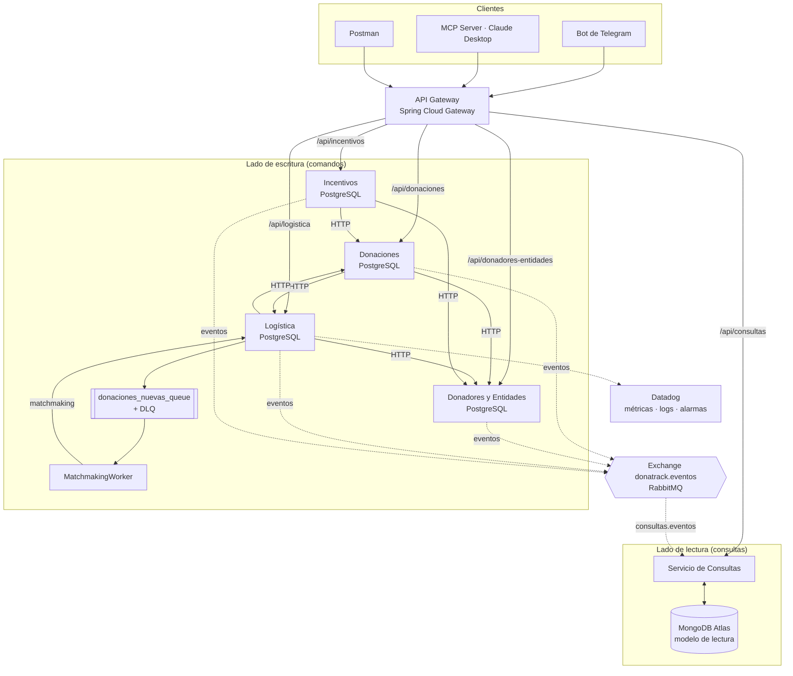

# DonaTrack

> Trabajo Práctico Anual - 2026
> Diseño de Sistemas de Información - UTN FRBA
> Grupo "Los 404"

DonaTrack es un sistema de gestión y trazabilidad de donaciones. Registra a los donadores y a las entidades que necesitan
productos. Recibe las donaciones, las guarda en depósitos y las asigna automáticamente a las necesidades más urgentes.
Sigue cada paquete hasta su entrega y premia a los donadores con misiones e insignias.

Está construido como un sistema de **microservicios**: cuatro módulos de negocio con su propia base de datos, que se
comunican por HTTP y por mensajería. Alrededor de esos módulos hay:

- un **API Gateway** como punto de entrada único;
- un **Servicio de Consultas** con el modelo de lectura en MongoDB (CQRS);
- un **Bot de Telegram** y un **MCP Server** para operar el sistema desde Claude.

### Integrantes del equipo

| Nombre           | Módulo principal              |
| ---------------- | ----------------------------- |
| Santiago Malirat | Logística · Servicio de Consultas |
| Marco Maggio     | Donaciones                    |
| Andry Carrasco   | Donadores y Entidades         |
| Carlos Herrera   | Incentivos                    |

---

## Arquitectura



### Flujo principal: de la donación a la entrega

1. El donador registra una donación en **Donaciones**. Donaciones valida con **Donadores y Entidades** que el donador
   pueda donar y se la manda a **Logística**.
2. Logística crea un paquete y lo guarda en el stock del depósito (o lo rechaza si no hay capacidad). Después encola el
   paquete en `donaciones_nuevas_queue`.
3. El **MatchmakingWorker** consume la cola y busca las necesidades de ese producto. Logística elige la más conveniente
   según el algoritmo del depósito (`SUB_ATENDIDOS` o `SCORE`) y arma la asignación.
4. Cuando se reporta la entrega, Logística completa la asignación y Donadores y Entidades actualiza la necesidad.
   **Incentivos** procesa el progreso de las misiones del donador.
5. Cada cambio de estado publica un **evento**. El Servicio de Consultas lo aplica sobre MongoDB y queda disponible para
   las consultas que cruzan módulos.

---

## Estructura del repositorio

Cada carpeta era un repositorio independiente durante la cursada. Se unificaron acá conservando su historial de commits.

| Carpeta | Componente | Tecnologías |
| --- | --- | --- |
| [`logistica/`](logistica) | Depósitos, stock, matchmaking, asignaciones y entregas. Worker de la cola de trabajo, métricas, alarmas y logs centralizados | Java 21 · Spring Boot · JPA · PostgreSQL · RabbitMQ · Datadog |
| [`donaciones/`](donaciones) | Donaciones, productos y categorías | Java · Spring Boot · JPA · PostgreSQL |
| [`donadores-y-entidades/`](donadores-y-entidades) | Donadores, entidades, necesidades y quejas | Java · Spring Boot · JPA · PostgreSQL |
| [`incentivos/`](incentivos) | Misiones, insignias y progreso de los donadores | Java · Spring Boot · JPA · PostgreSQL |
| [`servicio-consultas/`](servicio-consultas) | Lado de lectura del CQRS: consume los eventos y resuelve las consultas complejas | Java 21 · Spring Boot · Spring Data MongoDB · RabbitMQ |
| [`api-gateway/`](api-gateway) | Punto de entrada único: enruta `/api/<modulo>/**` a cada servicio | Spring Cloud Gateway (WebFlux) |
| [`mcp-server/`](mcp-server) | Tools para consultar y operar todo el sistema desde Claude Desktop | TypeScript · Model Context Protocol SDK |
| [`telegram-bot/`](telegram-bot) | Bot con menús de donador y de administrador para cada módulo | Java · TelegramBots (long polling) |

---

## Conceptos aplicados

- **Diseño por capas:** controladores, fachada y servicios, dominio y repositorios en cada módulo.
- **API REST** documentada con OpenAPI/Swagger y desplegada en Render.
- **Persistencia relacional** con JPA/Hibernate sobre PostgreSQL.
- **Integración sincrónica** entre módulos por HTTP, con manejo de errores (400/404/409) y compensaciones.
- **Integración asincrónica:**
  - una *work queue* con consumidores competidores, reintentos y dead letter queue;
  - un exchange *topic* de eventos para publish/subscribe.
- **Concurrencia:** análisis de condiciones de carrera entre workers (doble asignación, capacidad, redelivery) y sus
  soluciones (locking optimista y pesimista, idempotencia).
- **CQRS y consistencia eventual:**
  - los eventos se publican después del commit y llevan el estado completo;
  - el modelo de lectura se actualiza con upserts idempotentes que ignoran los eventos viejos o repetidos;
  - las consultas se resuelven con *aggregation pipelines* de MongoDB.
- **API Gateway** como punto de entrada único, separando el tráfico de comandos del de consultas.
- **Observabilidad:**
  - métricas de negocio con Micrometer y Datadog;
  - logs centralizados por HTTP;
  - alarmas con notificación por email.
- **Interfaces conversacionales:** bot de Telegram y servidor MCP para operar el sistema con lenguaje natural.

---

## Entregas

| Entrega | Objetivo | Qué se agregó |
| --- | --- | --- |
| 1 | Dominio y arquitectura base | Modelo de dominio de cada módulo, diseño por capas y diagramas de despliegue y componentes |
| 2 | API web y despliegue | Endpoints REST con controladores y servicios, despliegue en Render, primera integración sincrónica |
| 3 | Persistencia y métricas | ORM con JPA/Hibernate sobre PostgreSQL, métricas en Datadog y el sistema completo interconectado |
| 4 | Colas, workers y bot | Work queue con RabbitMQ, worker de matchmaking, análisis de concurrencia y bot de Telegram |
| 5 | MCP y logs centralizados | MCP Server para Claude Desktop, logs centralizados y más métricas |
| 6 | Gateway, CQRS y alarmas | API Gateway, eventos de los cuatro módulos, Servicio de Consultas con MongoDB y alarmas por email |

---

## Consultas complejas (modelo de lectura)

Se acceden por el gateway con el prefijo `/api/consultas`. Se resuelven solo contra MongoDB, sin llamar a los módulos.

| Endpoint | Consulta |
| --- | --- |
| `GET /donadores/{id}/ficha` | Ficha integral de un donador: categoría e historial, insignias, misión en curso, donaciones por estado, quejas y entidades beneficiadas |
| `GET /necesidades-urgentes` | Necesidades insatisfechas por urgencia, con el stock por depósito y lo asignado sin entregar |
| `GET /depositos/estado` | Ocupación, algoritmo, asignaciones por estado, entidades atendidas y tiempo promedio de entrega |
| `GET /calidad` | Proporción de donaciones con queja por categoría y ranking de donadores con más quejas |

---

## Ejecución local

Cada servicio Java se levanta de forma independiente:

```bash
cd logistica          # o cualquier otro servicio
mvn spring-boot:run
mvn test              # tests del servicio
```

El MCP Server:

```bash
cd mcp-server
npm install
npm start
```

Las variables de entorno de cada componente (bases de datos, RabbitMQ, MongoDB, Datadog, token del bot) están
documentadas en el README de su carpeta.
